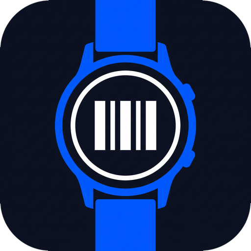

<div align="center">



# handyPVZ

**Штрихкод получения посылок Ozon — прямо на часах**


[](https://github.com/timsoid/handyPVZ/releases/latest)
[](https://t.me/+jZOjtFSWPWpiODYy)

</div>

---

## Что это

На пункте выдачи Ozon нужно показать штрихкод получения. handyPVZ достаёт его из вашего аккаунта и выводит на экран часов: достаточно поднести руку к сканеру, не доставая телефон.

Приложение состоит из двух частей:

- **Телефон (Android)** — входите в Ozon, приложение находит код получения и отправляет его на часы.
- **Часы (Wear OS)** — рисуют штрихкод Code128 на белой карточке с максимальной яркостью.

**Для работы приложения на часах необходимо установить handyPVZ и на смартфон:** именно телефон получает код из Ozon и передаёт его на часы. Отдельный APK для часов не заменяет приложение для телефона.

## Как это работает

1. Вы входите в профиль Ozon на странице внутри приложения (как в браузере). **Логин и пароль приложение не видит, не хранит и никуда не отправляет** — хранятся только cookie сессии на вашем телефоне.
2. Когда посылка приходит в пункт выдачи, Ozon присылает уведомление. handyPVZ замечает его, открывает «Мои заказы», находит код вида `12345678*1234` и отправляет его на часы.
3. На часах код превращается в штрихкод. Код меняется каждый день в 00:00 МСК; если на часах отметка «УСТАРЕЛ», откройте приложение на часах (оно само запросит свежий код у телефона) или нажмите «Обновить» на телефоне.

> **Важно:** в приложении Ozon должны быть включены уведомления о новых посылках, а handyPVZ нужен доступ к уведомлениям. Приложение намеренно **не опрашивает Ozon в фоне**: постоянная автоматическая активность выглядит подозрительно, и Ozon может закрыть сессию. Код запрашивается только по уведомлению, по кнопке «Обновить» или по запросу с часов.

## Уведомления: что именно видит приложение

Доступ к уведомлениям нужен только затем, чтобы узнать, что пришла посылка. Разберём, что при этом происходит, с ссылками на исходный код.

**Ограничение системы.** Android выдаёт разрешение «доступ к уведомлениям» целиком: технически система может передавать приложению любые уведомления, сузить это на уровне ОС нельзя. Поэтому фильтрация выполняется в самом коде — и это можно проверить.

**Первое действие — проверка имени приложения.** Всё, что не Ozon, отбрасывается сразу, ещё до какого-либо чтения:

```kotlin
override fun onNotificationPosted(sbn: StatusBarNotification) {
    if (!isOzonPackage(sbn.packageName)) return   // игнорируем всё, кроме Ozon
    ...
}

private fun isOzonPackage(pkg: String): Boolean =
    pkg == "ru.ozon.app.android" || pkg == "ru.ozon.fresh"
```

Источник: [`OzonNotificationService.kt`](app/src/main/java/dev/handypvz/OzonNotificationService.kt). Обрабатываются только уведомления приложений Ozon (`ru.ozon.app.android` и `ru.ozon.fresh`).

**Содержимое не читается.** Приложению нужен только сам факт «пришло уведомление от Ozon». Текст, заголовок и картинки уведомления в коде не используются, нигде не сохраняются и никуда не отправляются.

**Что происходит дальше.** По этому сигналу приложение открывает вашу же Ozon-сессию (скрытый WebView с cookie на вашем телефоне) и достаёт код получения — как если бы вы сами открыли «Мои заказы». Данные уведомления в этом не участвуют.

**Как убедиться самому.** Проект открытый: исходники в этом репозитории, любой может собрать приложение сам или попросить разработчика проверить. Простой тест — отправьте себе уведомление от любого другого приложения: handyPVZ на него не отреагирует, потому что фильтр пропускает только Ozon.

## Установка

### 1. Телефон

1. Скачайте `handyPVZ-<версия>.apk` (не `handyPVZ-wear-…`, это файл для часов) из [последнего релиза](https://github.com/timsoid/handyPVZ/releases/latest).
2. Откройте файл и разрешите установку из неизвестных источников.
3. Откройте приложение и войдите в профиль Ozon.
4. Выдайте доступ к уведомлениям (приложение подскажет) и включите уведомления о посылках в самом Ozon.

### 2. Часы

APK для часов уже вшит в приложение на телефоне, отдельно скачивать ничего не нужно. Установка идёт по беспроводной отладке (ADB по Wi-Fi):

1. Телефон и часы должны быть в одной Wi-Fi сети.
2. На часах: **Настройки → О часах → Сведения о ПО** → 7 раз нажмите на «Номер сборки» (если режим разработчика ещё не включён).
3. В разделе **«Для разработчиков»** (или «Параметры разработчика») включите «Отладка по ADB» и «Отладка по Wi-Fi» (или «Беспроводная отладка»).
4. Откройте «Отладка по Wi-Fi» и нажмите **«Подключить новое устройство»**: на часах появятся IP-адрес с портом и 6-значный код. Экран оставьте открытым.
5. На телефоне нажмите **«Установить на часы»**, введите код и нажмите «Установить». IP-адрес и порт сопряжения подставятся сами, порт подключения тоже находится автоматически. Если автоопределение не сработало, впишите адрес и порт вручную.

Приложение само выполнит сопряжение, подключение и установку. Повторно сопрягать часы при обновлениях не нужно.

**Не получилось установить из приложения?** В каждом релизе лежит отдельный файл для часов `handyPVZ-wear-<версия>.apk`. Его можно поставить на часы любым привычным способом, например через `adb install` или сторонние установщики для Wear OS. Он подписан тем же ключом, что и приложение телефона, поэтому они увидят друг друга. Если нужна помощь, загляните в [Telegram-группу](https://t.me/+jZOjtFSWPWpiODYy): там есть альтернативная инструкция.

## Требования

- Телефон на Android 11 или новее.
- Часы на Wear OS (Galaxy Watch 4 и новее, Pixel Watch и др.) с поддержкой беспроводной отладки.
- Аккаунт Ozon и пункт выдачи/постамат Ozon.

## Конфиденциальность

- Логин, пароль и коды из SMS приложение не видит: вход выполняется на настоящей странице Ozon.
- Код получения и сессия хранятся только на ваших устройствах. Резервное копирование отключено.
- Для обезличенной статистики использования применяется [Яндекс AppMetrica](https://appmetrica.yandex.ru). В сборках из исходников без ключа аналитика выключена.

## Сборка из исходников

Требуются JDK 17+ и Android SDK. Один модуль собирает другой автоматически: `:app` собирает `:wear` и вшивает его APK как `wear_app.apk`.

```bash
# путь к SDK
echo "sdk.dir=/path/to/Android/sdk" > local.properties

./gradlew :app:assembleDebug        # app/build/outputs/apk/debug/
./gradlew :app:assembleRelease      # подписывается, если есть keystore.properties
./scripts/release.sh                # релиз на GitHub: APK телефона + APK часов + SHA256SUMS
```

Подпись релиза (оба модуля должны быть подписаны **одним** ключом, иначе телефон и часы не свяжутся) — файл `keystore.properties` в корне (в `.gitignore`):

```properties
storeFile=/путь/к/release.jks
storePassword=...
keyAlias=...
keyPassword=...
```

Необязательно: ключ AppMetrica в `local.properties` (`appmetrica.apiKey=...`) или переменная `APPMETRICA_API_KEY`.

> Если телефон и часы подключены по adb одновременно, **не запускайте `installDebug` без `ANDROID_SERIAL`**: у модулей одинаковый `applicationId`, и APK телефона окажется на часах.

Подробное описание архитектуры — в [AGENTS.md](AGENTS.md).

## Поддержка и обратная связь

- Вопросы, баги и предложения: [Telegram-группа](https://t.me/+jZOjtFSWPWpiODYy) или [Issues](https://github.com/timsoid/handyPVZ/issues).
- Новые версии: [Releases](https://github.com/timsoid/handyPVZ/releases).

## Поддержать проект

Приложение бесплатное и без рекламы. Если оно сэкономило вам время в очереди, можно поддержать разработку:

[](https://pay.cloudtips.ru/p/eabd1029)

---

<div align="center">

Проект независимый и никак не связан с Ozon. Ozon — торговая марка соответствующего правообладателя.

</div>
